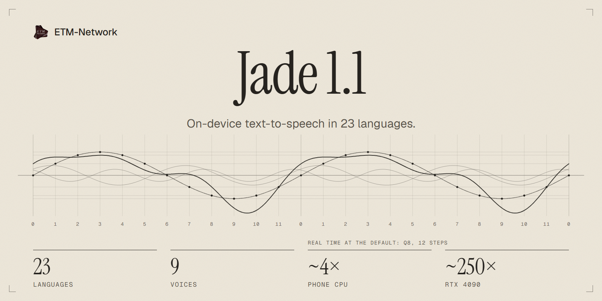

# Jade



Runtimes for [Jade 1.1](https://huggingface.co/ETM-Network/jade-1.1), an on-device text-to-speech model: nine voices, 23 languages, about four times faster than real time on a mid-range phone CPU at the default settings.

Jade 1.1 is an early release: training didn't go entirely to plan, and some of that is still audible (see the [limitations](https://huggingface.co/ETM-Network/jade-1.1#limitations)). Jade 1.2 follows soon with more voices, steadier long-form reading and higher quality, again with open weights and code.

| folder | |
|---|---|
| [`py/`](py) | Python package `etm-tts`: ONNX Runtime and MLX, with a command line |
| [`android/`](android) | Kotlin library on ONNX Runtime Mobile |

```
pip install etm-tts
etm-tts speak "Hello there." -o hello.wav
```

The default is the q8 files at 12 steps, which we recommend for long-form reading. q4 and q3 are smaller and faster, but over long passages they can make pitch errors, especially at few steps.

## Licence

The code is licensed under [Apache 2.0](LICENSE). The model weights are published separately under the BigScience OpenRAIL-M licence, which restricts certain uses; see the [model card](https://huggingface.co/ETM-Network/jade-1.1).
